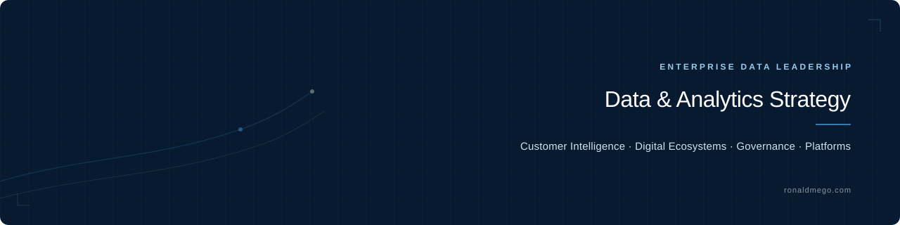

# Ronald Mego

**Data & Analytics Executive | Enterprise Data Strategy | Customer Intelligence | Governance & Agentic AI**

> I trained as a statistical engineer. The question that guides my work is how data and technology can help people and organizations make better decisions.

I lead, from HQ, the regional data and analytics strategy for Tigo’s digital ecosystem, in coordination with the country teams, connecting Customer Intelligence and governance with product and management decisions. My recent work includes platform modernization and AI agents in production. My path spans telecom, fintech and media, from Peru to Panama.

[Website](https://ronaldmego.com) · [LinkedIn](https://linkedin.com/in/ronaldmego) · [X](https://x.com/ronaldmego_) · [YouTube](https://youtube.com/@ronaldmego)
