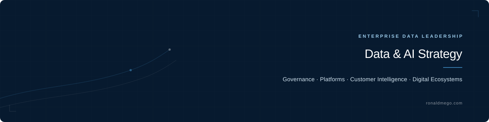

# Ronald Mego

**Data & Analytics Executive | Enterprise Data Strategy | Governance | Data Platforms | Customer Intelligence | Digital Ecosystems | Agentic AI**

> I learned to see the world through statistics. What has kept me curious ever since is a bigger question: how can data and technology help people and organizations make better decisions?

I lead regional data and analytics strategy for Tigo’s digital ecosystem, connecting governance, architecture, observability, Customer Intelligence and Agentic AI with product and management decisions. My path spans telecom, fintech and media, from Peru to Panama.

[Website](https://ronaldmego.com) · [LinkedIn](https://linkedin.com/in/ronaldmego) · [X](https://x.com/ronaldmego_) · [YouTube](https://youtube.com/@ronaldmego)
